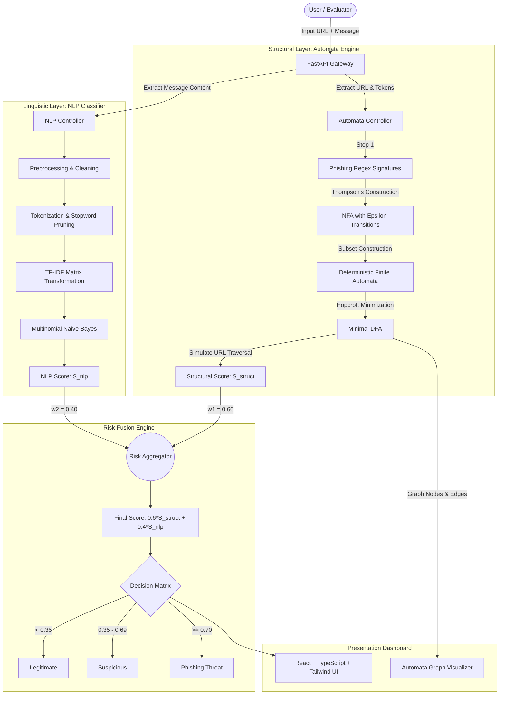

# PhishGuard — System Architecture Specification

## 1. System Overview

PhishGuard implements a dual-layer threat evaluation engine for analyzing phishing vectors. The design combines formal language theory (Models of Computation) with statistical Natural Language Processing (NLP).

The core rationale for this hybrid paradigm:
1. **Determinism at the Perimeter:** URL parsing and structural lexical validation are converted to minimal Deterministic Finite Automata (DFA), guaranteeing linear-time complexity $\mathcal{O}(L)$ with respect to URL length $L$, independent of rule complexity.
2. **Contextual Resilience:** Lexical parsing cannot infer intent from deceptive messaging. The NLP layer applies statistical text classification to evaluate psychological persuasion patterns (urgency, credential harvesting prompts, fear-inducing calls to action).
3. **Calibrated Fusion:** Both signals are unified into a normalized interval $[0, 1]$ using empirical risk weighting.

---

## 2. High-Level Component Pipeline

---

## 3. Layer Specifications

### 3.1 Structural Layer (Automata Theory)

The structural layer identifies common uniform resource identifier (URI) manipulation patterns:
- **Obfuscated IP addresses:** Hexadecimal, octal, or dotted-decimal formats in domain positions.
- **Excessive Subdomain Stacking:** e.g., `paypal.com.account-verification.xyz`.
- **Targeted Brand Keywords:** Sensitive vocabulary (`secure`, `login`, `billing`, `update`) in anomalous path/query locations.
- **Top-Level Domain (TLD) Anomaly:** Free/abused generic top-level domains associated with rapid disposable campaigns.

#### Automata Transformation Pipeline
1. **Regular Expression Definition:** Structural patterns are expressed via standard formal regular expressions over the ASCII alphabet $\Sigma$.
2. **Thompson's Construction ($\epsilon$-NFA):**
   - Base cases: $\epsilon$-transition and single character transitions.
   - Inductive operators: Concatenation ($AB$), Union ($A \mid B$), and Kleene Star ($A^*$).
   - Yields an NFA $M = (Q, \Sigma, \delta, q_0, F)$ with at most $2|R|$ states and $4|R|$ transitions.
3. **Subset Construction (Powerset Algorithm):**
   - Computes $\epsilon\text{-closure}(s)$ for state sets.
   - Builds deterministic transition table $\delta_D(S, a) = \epsilon\text{-closure}\left(\bigcup_{s \in S} \delta(s, a)\right)$.
   - Every DFA state corresponds to a subset of NFA states.
4. **DFA Minimization:**
   - Eliminates dead and unreachable states from the start state $q_0$.
   - Divides states into initial partitions: accepting states $F$ and non-accepting states $Q \setminus F$.
   - Iteratively refines partitions until no further distinguishable state pairs exist.
   - Generates minimal isomorphic state representation.

---

### 3.2 NLP Layer (Content & Semantic Evaluation)

The NLP layer processes message text associated with the suspicious link:
- **Preprocessing:** Strip zero-width spaces, normalize casing, replace email/phone patterns with generic symbols.
- **Stopword Pruning:** Filter non-discriminative English stopwords while preserving modal verbs indicating urgency (`urgent`, `immediately`, `within 24 hours`).
- **TF-IDF Vectorization:**
  $$\text{TF-IDF}(t, d, D) = \text{TF}(t, d) \times \log\left(\frac{1 + |D|}{1 + |\{d \in D : t \in d\}|}\right) + 1$$
- **Multinomial Naive Bayes Classification:**
  $$P(\text{Phishing} \mid \mathbf{x}) \propto P(\text{Phishing}) \prod_{i=1}^n P(x_i \mid \text{Phishing})^{f_i}$$
  Outputs posterior probability $S_{\text{nlp}} \in [0, 1]$.

---

### 3.3 Risk Fusion Layer

The fusion formula produces the unified score:
$$\text{Score} = w_1 \cdot S_{\text{struct}} + w_2 \cdot S_{\text{nlp}}$$
where:
$$w_1 = 0.60, \quad w_2 = 0.40, \quad w_1 + w_2 = 1.0$$

The weighting attributes higher baseline confidence ($60\%$) to deterministic structural anomalies (since legitimate domains rarely use misleading subdomain chains or IP hosting), while contextual language contributes $40\%$ to account for false positives or subtle phishing lures.

---

## 4. API Endpoints (Planned)

| Method | Route | Description |
|---|---|---|
| `GET` | `/api/health` | Service health status check |
| `POST` | `/api/detect` | Full scan accepting URL and message text, returning fusion scores |
| `POST` | `/api/automata/simulate` | Traces a URL string through the minimal DFA, returning step-by-step state visits |
| `GET` | `/api/automata/graph` | Exports JSON representation of NFA and DFA nodes and edges for rendering |
